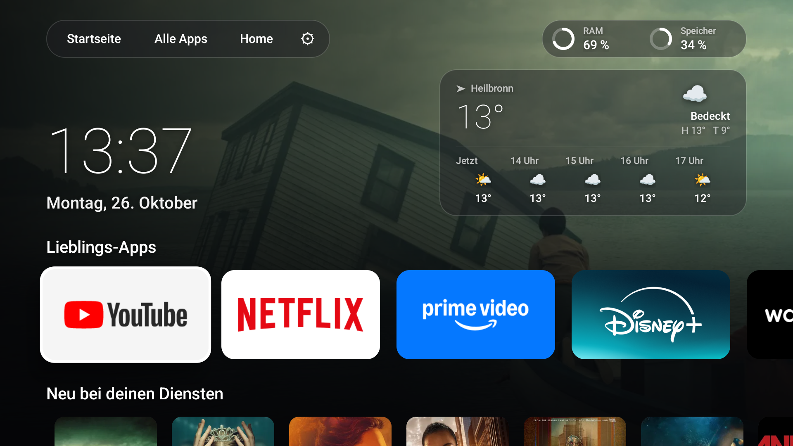
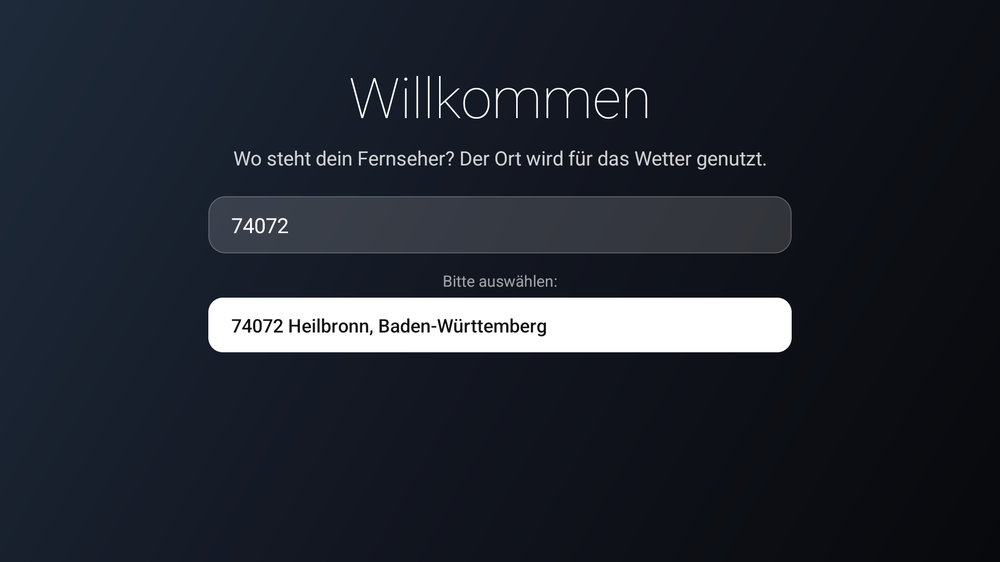
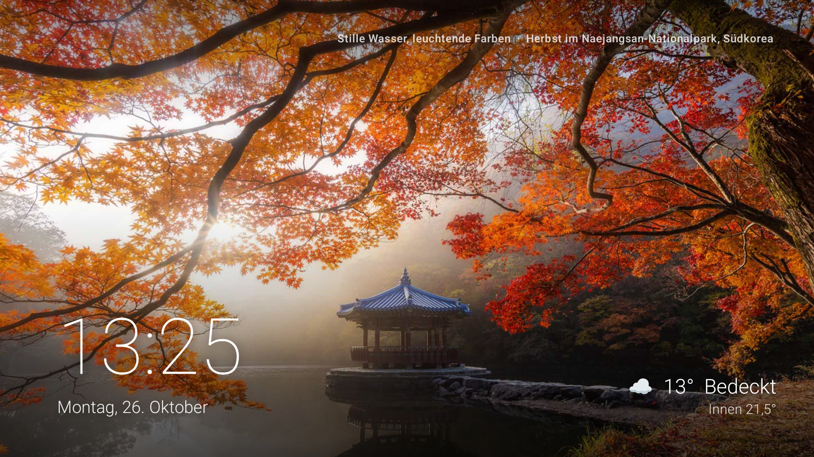

# MoreSmarterTV

Ein eigener Startbildschirm für Google TV / Android TV – mit Smart-Home-Steuerung, Wetter,
Neuheiten der installierten Streamingdienste, einem Ambient-Bildschirmschoner und einem
eigenen AirPlay-Empfänger. Gebaut ohne Gradle, nur mit den Android-SDK-Werkzeugen.



## Funktionen

**Launcher (`launcher/`)**

- **Startseite** – große Uhr, Wetterkarte mit Stundenvorschau, RAM/Speicher-Anzeige,
  Lieblings-Apps mit TV-Bannern und „Neu bei deinen Diensten“: aktuelle, beliebte Filme und
  Serien nur von den Streaming-Apps, die tatsächlich installiert sind (Daten: JustWatch).
  Beim Herunterscrollen gleitet die Ansicht hoch, das Hintergrundbild blendet zum gewählten Titel über.
- **Alle Apps** – Raster aller Apps, langes OK fügt Favoriten hinzu oder entfernt sie.
- **Home** – Smart-Home-Seite im Stil der Apple-TV-Home-Ansicht: Wetter, Uhrzeit und ein frei
  wählbarer Raum oben, darunter Kamera-Platzhalter (UniFi Protect), Geräte und Szenen.
  - Govee-LED-Streifen über die lokale LAN-API (Ein/Aus, Helligkeit, Farben, Szenen)
  - Heizung über **Homematic IP** (Cloud-API) und **Bosch Smart Home** (lokale API)
  - Steuerung als Milchglas-Karte mit großem Regler (▲/▼) und Schnellwahl
  - Cloud-Systeme werden nur beim Öffnen der Seite und nach Änderungen abgefragt
- **Ersteinrichtung** – beim ersten Start wird der Ort für das Wetter per PLZ oder Name gewählt;
  später änderbar über OK auf das Wetter im Home-Tab.

  
- **Ambient-Bildschirmschoner** – Landschaftsfotos (Bing-Bild des Tages) mit langsamem Zoom und
  Überblendung, Uhr, Wetter und Raumtemperatur; Texte wandern leicht gegen Einbrennen.



**AirPlay-Empfänger (`airplay/`)**

Bildschirmsynchronisierung von iPhone, iPad und Mac auf den Fernseher (H.264-Video, AAC-Ton),
mit Startbildschirm und Einstellungen im Stil von tvOS. Das Protokoll (Pairing, FairPlay)
stammt aus [java-airplay-lib](https://github.com/serezhka/java-airplay-lib) (MIT).


## Vorbereitung: Entwicklermodus auf Android TV / Google TV

Damit ein Computer Apps auf die Box installieren darf, muss dort der Entwicklermodus mit
Debugging übers Netzwerk an sein. Das geht nur mit der Fernbedienung am Fernseher:

1. **Entwickleroptionen freischalten**
   - **Einstellungen → System → Info** öffnen
     (bei älterem Android TV: *Einstellungen → Geräteeinstellungen → Info*).
   - Nach unten bis **„Android TV OS-Build“** (bzw. „Build“) gehen und **7× OK drücken**.
   - Es erscheint „Sie sind jetzt Entwickler“. Ggf. die PIN bzw. das Google-Konto bestätigen.
2. **Debugging einschalten**
   - Zurück zu **Einstellungen → System → Entwickleroptionen**.
   - **Google TV / Android 11 und neuer:** **„Kabelloses Debugging“** (Debugging über WLAN) aktivieren.
     Darunter stehen **IP-Adresse & Port**, z. B. `192.168.1.50:37123`.
   - **Älteres Android TV:** **„USB-Debugging“** bzw. **„Netzwerk-Debugging“** aktivieren; dann gilt Port `5555`.
3. **Mit dem Computer verbinden** (Android SDK Platform-Tools installiert, `adb` im Pfad)
   - Zum ersten Mal: unter „Kabelloses Debugging“ **„Gerät über einen Kopplungscode koppeln“** wählen
     und auf dem Computer `adb pair <IP:Kopplungsport>` mit dem angezeigten 6-stelligen Code eingeben.
   - Danach: `adb connect <IP:Port>` – beim älteren Netzwerk-Debugging erscheint stattdessen auf dem
     Fernseher die Frage „USB-Debugging zulassen?“ → **Immer zulassen**.
   - `adb devices` zeigt die Box dann als `device` an.

> Tipp: Der Port beim kabellosen Debugging ändert sich nach jedem Neustart der Box –
> einfach unter Entwickleroptionen nachsehen.

## Installation mit Claude Code

Am einfachsten lässt du dir alles von [Claude Code](https://claude.com/claude-code) einrichten.

### All-in-one-Prompt

Nach der Vorbereitung oben nur `<IP:Port>` durch die Adresse aus „Kabelloses Debugging“ ersetzen:

```text
Richte MoreSmarterTV (https://github.com/adriankrypton/moresmartertv) auf meiner Google-TV-Box
unter <IP:Port> komplett ein:

1. Verbinde dich per adb mit der Box. Verlangt sie eine Kopplung, sag mir genau, wo ich auf dem
   Fernseher den Kopplungscode finde, und warte auf meine Angaben.
2. Installiere bei Bedarf JDK 17 und das Android SDK (platform-tools, build-tools 34, platform 34).
3. Klone das Repository, baue launcher und airplay mit den build.sh-Skripten und installiere
   beide APKs auf der Box.
4. Richte den Launcher wie im README als Startbildschirm ein (set-home-activity, Google-TV-Launcher
   und setupwraith deaktivieren) und aktiviere den Ambient-Bildschirmschoner.
5. Öffne den Launcher. Bei der Ersteinrichtung frag mich nach meiner Postleitzahl für das Wetter.
6. Frag mich, welche Smart-Home-Geräte ich habe (Govee-LED, Homematic IP Access Point,
   Bosch Smart Home Controller): trag IP-Adressen und Namen ein und kopple die Heizungen mit den
   Skripten aus launcher/pairing – Passwörter und Codes gebe ich selbst im Terminal ein.
   Baue danach den Launcher neu und installiere ihn.
7. Zeig mir zum Schluss Screenshots von Startseite und Home-Tab und erkläre mir,
   wie ich alles wieder rückgängig mache.
```

### Einzelne Schritte

Alternativ Schritt für Schritt, Platzhalter `<…>` ersetzen:

**1. Mit der Box verbinden**

```text
Verbinde dich per adb mit meiner Google-TV-Box unter <IP:Port>. Falls sie Kopplung verlangt,
sag mir, wo ich den Kopplungscode auf dem Fernseher finde.
```

**2. Launcher und AirPlay installieren**

```text
Klone https://github.com/adriankrypton/moresmartertv, installiere falls nötig JDK 17 und das
Android SDK (build-tools 34, platform 34), baue launcher und airplay mit den build.sh-Skripten,
installiere beide APKs per adb auf der Box und richte den Launcher wie im README beschrieben als
Startbildschirm ein. Zeig mir danach einen Screenshot vom Fernseher.
```

**3. Eigene Geräte eintragen**

```text
Trag in MoreSmarterTV meine Geräte ein: Govee-LED-Streifen unter <IP> mit dem Namen <Name>,
Bosch Smart Home Controller unter <IP>. Baue den Launcher neu und installiere ihn.
```

**4. Heizung koppeln** (Zugangsdaten bleiben lokal und kommen nie ins Repository)

```text
Kopple MoreSmarterTV mit meinem Homematic IP Access Point über launcher/pairing/register-hmip.py
und mit meinem Bosch Smart Home Controller über launcher/pairing/register-bosch.py. Öffne die
Skripte jeweils in einem Terminal-Tab, damit ich SGTIN bzw. Systempasswort selbst eingebe, und
sag mir, wann ich die Taste am Gerät drücken soll. Baue danach den Launcher neu und installiere ihn.
```

**5. Bildschirmschoner aktivieren**

```text
Stell auf meiner Box den MoreSmarterTV-Bildschirmschoner (com.adrian.tvhome/.AmbientDream) ein.
```

**6. Alles rückgängig machen**

```text
Mach den Google-TV-Launcher wieder zum Startbildschirm: aktiviere com.google.android.apps.tv.launcherx
und com.google.android.tungsten.setupwraith wieder und deinstalliere com.adrian.tvhome und com.adrian.airplay.
```

## Bauen

Voraussetzungen: JDK 17, Android SDK mit `build-tools/34.0.0` und `platforms/android-34`
(Pfad über `ANDROID_HOME` oder Standardpfad unter Windows), Git Bash oder eine andere Bash.

```bash
cd launcher && bash build.sh      # -> launcher/build/tvhome.apk
cd airplay  && bash build.sh      # -> airplay/build/airplay.apk (lädt seine Bibliotheken von Maven Central)
```

Beim ersten Build wird ein eigener Debug-Signaturschlüssel (`launcher/debug.keystore`) erzeugt;
er ist in `.gitignore` und landet nie im Repository.

## Installieren

```bash
adb connect <tv-ip>:<port>
adb install -r launcher/build/tvhome.apk
adb install -r airplay/build/airplay.apk
```

Als Startbildschirm setzen (Google TV leitet die Home-Taste sonst immer auf den eigenen Launcher):

```bash
adb shell cmd package set-home-activity com.adrian.tvhome/.MainActivity
adb shell pm disable-user --user 0 com.google.android.apps.tv.launcherx
adb shell pm disable-user --user 0 com.google.android.tungsten.setupwraith
```

Rückgängig machen mit `pm enable` für beide Pakete.

Lautstärke-Anzeige im tvOS-Stil (nur bei Ton über Bluetooth; sonst zeigt der Fernseher seine eigene):

```bash
adb shell settings put secure enabled_accessibility_services com.adrian.tvhome/com.adrian.tvhome.VolumeHud
adb shell settings put secure accessibility_enabled 1
```

Bildschirmschoner aktivieren:

```bash
adb shell settings put secure screensaver_components com.adrian.tvhome/.AmbientDream
```

## Fire TV

Der Launcher läuft auch auf Fire TV (ab Fire OS 6 / Android 7.1). Fire OS lässt den
Amazon-Startbildschirm weder ersetzen noch deaktivieren; ein kleiner Wächter im Launcher holt
MoreSmarterTV deshalb sofort nach vorne, sobald das Amazon-Home erscheint – auch nach einem Neustart.
Dafür einmalig die Nutzungsstatistik freigeben:

```bash
adb install -r launcher/build/tvhome.apk
adb shell appops set com.adrian.tvhome GET_USAGE_STATS allow
adb shell appops set com.adrian.tvhome SYSTEM_ALERT_WINDOW allow
```

Fire OS hält App-Starts nach einem Home-Tastendruck rund 5 Sekunden zurück. Der Launcher legt
deshalb sofort ein Bild von sich selbst über das Amazon-Home.

- **Fire OS 7/8:** Der Start läuft über einen AlarmManager-Alarm, den `system_server` auslöst und
  der von der Sperre ausgenommen ist (Idee: [firetv-tvos](https://github.com/NikhilSiddhu/firetv-tvos)).
  Der Wechsel dauert dann nur Sekundenbruchteile. Dafür zusätzlich:
  `adb shell settings put global alarm_manager_constants min_futurity=0`
- **Fire OS 6:** Die Sperre lässt sich ohne Root nicht umgehen. Das Bild bleibt etwa 5 Sekunden
  stehen und fängt in der Zeit Tastendrücke ab, dann ist MoreSmarterTV wirklich vorne.

Werbung und Telemetrie lassen sich umkehrbar abschalten (`pm enable <paket>` macht es rückgängig):

```bash
for p in com.amazon.kso.blackbird com.amazon.sneakpeek com.amazon.hybridadidservice          com.amazon.shoptv.firetv.client com.amazon.imdb.tv.android.app com.imdb.livingroom.firetv          com.amazon.minitv.android.app com.amazon.tv.easyupgrade com.amazon.dp.logger          com.amazon.perfcollection com.amazon.tv.fw.metrics com.amazon.wirelessmetrics.service com.amazon.logan; do
  adb shell pm disable-user --user 0 $p
done
adb shell settings put secure limit_ad_tracking 1
```

Die AirPlay-App braucht Android 12 und läuft daher nicht auf Fire TV.

## Smart Home koppeln

Zugangsdaten werden **nicht** im Repository gespeichert. Die Kopplungsskripte legen sie in
`launcher/assets/` ab (per `.gitignore` ausgeschlossen); danach den Launcher neu bauen.

- **Bosch Smart Home:** `python launcher/pairing/register-bosch.py <controller-ip> <gerätename>` –
  Systempasswort eingeben, dann die Taste am Controller kurz drücken (Controller II).
  Jeder Fernseher braucht einen eigenen Gerätenamen, sonst ersetzt die zweite Kopplung die erste.
- **Homematic IP:** `python launcher/pairing/register-hmip.py` – SGTIN des Access Points
  eingeben (Aufkleber, beginnt mit `3014F711`), dann die blaue Taste drücken.

Eigene Geräte stehen in `launcher/assets/home.json` (per `.gitignore` ausgeschlossen):

```json
{ "govee": { "ip": "192.168.1.50", "name": "LED Strip" },
  "bosch": "192.168.1.60" }
```

Ohne Eintrag sucht der Launcher Govee-Lampen selbst im Netz (dafür in der Govee-App
„LAN-Steuerung“ aktivieren).

## Datenquellen

Wetter: [Open-Meteo](https://open-meteo.com) · Ortssuche: Open-Meteo Geocoding, zippopotam.us ·
Neuheiten: JustWatch (inoffizielle API) · Bildschirmschoner: Bing-Bild des Tages.

## Hinweise

Privates Bastelprojekt, nicht mit Apple, Google, Bosch, eQ-3, Govee oder JustWatch verbunden.
AirPlay ist eine Marke von Apple Inc.
